# FIRELINE SI — Flame in Free Fall

**An SI-powered research dashboard for exploring NASA microgravity combustion data and fire-safety research.**

> **Project team:** Kashaf · Mishkat · Zain ul Abideen  
> **Challenge:** 2026 NASA Space Apps Challenge — *Flame in Freefall: SI-Powered Fire Safety Insights from Microgravity Combustion Data*  
> **Live dashboard:** https://fireline-si-atvbpz.v2.appdeploy.ai/

## Table of contents
- [Problem statement](#problem-statement)
- [Our solution](#our-solution)
- [Objectives](#objectives)
- [Dataset and data sources](#dataset-and-data-sources)
- [Dashboard modules](#dashboard-modules)
- [How it works](#how-it-works)
- [Technology stack](#technology-stack)
- [Project structure](#project-structure)
- [Run locally](#run-locally)
- [Data quality notes and limitations](#data-quality-notes-and-limitations)
- [System architecture](#system-architecture)
- [Screenshots and UI previews](#screenshots-and-ui-previews)
- [Resources and references](#resources-and-references)
- [Team](#team)
- [License](#license)

## Problem statement

Fire behaves differently in microgravity because buoyancy-driven convection is greatly reduced. Flames can become more spherical and rely more strongly on diffusion and the local flow environment. Understanding ignition, flame spread, material flammability, smoke behaviour, and fire suppression is important for crew safety in spacecraft and future Moon and Mars habitats.

NASA and its research partners have conducted many low-gravity combustion investigations. However, research records and resources can be distributed across investigations and formats, making them difficult to find, compare, and interpret efficiently.

**Challenge question:** How can complex microgravity combustion research be organized into an accessible experience that helps users explore investigations, notice data patterns, and identify questions requiring scientific verification?

## Our solution

FIRELINE SI is an interactive web dashboard that organizes a supplied NASA Physical Sciences Informatics (PSI) combustion-data summary into a single research interface. It presents dataset coverage, supports investigation exploration, visualizes the supplied flammability index, highlights potential data-quality issues, and provides an evidence-aware SI Analyst research brief.

The dashboard is intended for **research exploration**. It is not a certified fire-risk model, spacecraft safety system, or substitute for NASA engineering review.

## Objectives
1. Make the supplied microgravity combustion dataset easier to navigate.
2. Summarize investigations, research categories, and fuel classifications.
3. Support filtering and comparison of investigation-level summaries.
4. Visualize the supplied flammability index without claiming it is a validated NASA rating.
5. Highlight unusual values and duplicate records for human review.
6. Explain findings, uncertainty, and recommended follow-up checks.
7. Connect users to NASA research and media resources.

## Dataset and data sources

### Dataset used by the dashboard

The dashboard data summary is embedded in [`src/data.ts`](src/data.ts). It represents the supplied master CSV named **`nasa_fire_safety_master (1).csv`**.

| Dataset attribute | Reported value |
|---|---:|
| Source rows | 2,855 |
| Investigation codes | 13 |
| Research categories | 6 |
| Fuel classifications | 8 |
| Unique exact rows | 562 |
| Exact duplicate rows | 2,293 (about 80.3%) |
| Missing cells in the 10 analyzed columns | 0 |

The investigation-level summaries include PSI-10, PSI-159, PSI-20, PSI-21, PSI-22, PSI-23, PSI-26, PSI-39, PSI-47, PSI-68, PSI-69, PSI-98, and PSI-99.

**Data availability note:** The original full `nasa_fire_safety_master (1).csv` file is not included in this dashboard ZIP. This project package contains precomputed investigation/category/fuel summaries and quality indicators in `src/data.ts`, not the full row-level source CSV. The separate raw-data scaffold/sample package is not the same as the full master CSV.

### NASA / challenge sources
- [2026 NASA Space Apps Challenge — Flame in Freefall](https://www.spaceappschallenge.org/2026/challenges/flame-in-freefall/)
- [NASA Physical Sciences Informatics (PSI)](https://psi.nasa.gov/)
- [NASA PSI Repository](https://psi.nasa.gov/physci/repo/)
- [NASA Data — Entry Points](https://science.nasa.gov/learn/entry-points-to-nasa-data/)
- [NASA Image and Video Library](https://images.nasa.gov/)

Use the challenge page and PSI repository to locate original investigation records, publications, and source files. Verify investigation identifiers, units, metadata, and provenance against the original NASA record before scientific reuse.

## Dashboard modules
| Module | What it does |
|---|---|
| **Mission Overview** | Shows dataset coverage, investigation counts, research categories, and key data counts. |
| **Investigation Explorer** | Filters the investigation catalogue by category, fuel class, and text search; displays profiles and supports CSV export of the filtered summary. |
| **Risk Intelligence** | Visualizes and compares supplied flammability-index summaries and index bands. |
| **Data Quality** | Highlights exact duplicates, unusual oxygen values, high pressure values, and zero-flow entries for source verification. |
| **SI Analyst** | Produces an offline, evidence-aware research brief from the selected investigation summary and known quality notes. |
| **NASA Media & Resources** | Links to NASA PSI, NASA data resources, imagery, and a search-based NASA fire-research video embed. |
| **Moon & Mars Safety** | Presents atmospheric planning scenarios and the prevention, detection, and suppression pillars. |

## How it works

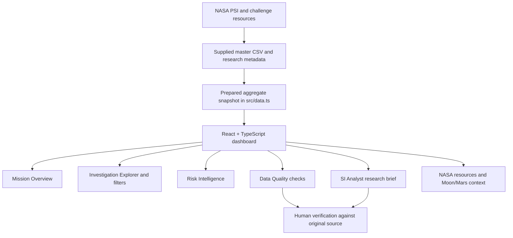

### User workflow
1. Open the dashboard and review Mission Overview.
2. Open Investigation Explorer and search or filter by investigation, category, or fuel class.
3. Select an investigation to inspect its available summary.
4. Compare supplied index summaries in Risk Intelligence.
5. Review Data Quality flags before drawing conclusions.
6. Generate an SI Analyst brief to read observed signals, interpretation limits, and recommended next checks.
7. Follow NASA source links to verify values and interpretations.

## Technology stack
| Technology | Use |
|---|---|
| **React 19** | Component-based user interface. |
| **TypeScript** | Typed application code and data structures. |
| **Vite 6** | Local development server and production build tooling. |
| **Lucide React** | Interface icons. |
| **CSS** | Responsive layout, visual theme, panels, charts, and dashboard styling. |
| **Browser Blob API** | Downloads the filtered investigation summary as CSV. |

The current local SI Analyst is an **offline template-based research brief**. It does not call a live generative-AI API. The hosted AppDeploy version may have platform-specific behaviour that is not included in this local reconstruction.

## Project structure
```text
FIRELINE-SI/
├── index.html
├── package.json
├── vite.config.ts
├── tsconfig.json
├── tailwind.config.js
├── postcss.config.js
├── LICENSE
├── README.md
├── .gitignore
├── .env.example
├── .env (local only; ignored by Git)
├── src/ (main.tsx, App.tsx, data.ts, index.css)
├── backend/ (index.ts, realtime.ts, realtime-subscribers.ts)
├── tests/tests.json
└── docs/ (images/ with mission-overview.svg, investigation-explorer.svg, data-quality.svg; architecture/system-architecture.svg; screenshots/ for genuine browser captures)
```

## Run locally
**Requirements:** Node.js (LTS recommended), npm, and VS Code or another code editor.

1. Download and extract the project ZIP.
2. Open the `FIRELINE-SI` folder in VS Code.
3. Choose **Terminal → New Terminal**.
4. Ensure the terminal is in the project folder.
5. Install dependencies:
   ```bash
   npm install --legacy-peer-deps
   ```
6. Start the development server:
   ```bash
   npm run dev
   ```
7. Open the local URL printed by Vite, usually `http://localhost:5173/`.

### Production build
```bash
npm run build
npm run preview
```

## Data quality notes and limitations
- **2,293 exact duplicate rows** were reported among 2,855 source rows. Repeated measurements and duplicated exports must be distinguished using original run identifiers and metadata.
- **Two PSI-20 oxygen values (2,100 and 3,400)** appear in a percentage-named field. They are flagged for source/encoding/unit verification and are not automatically corrected.
- **170 pressure values above 100 psi** are flagged for unit and experimental-context verification.
- **2,589 zero-flow values** are present. Confirm whether these represent measured zero flow, unavailable measurements, or a coding convention.
- The formula and calibration of `flammability_risk_index` were not documented in the available project materials. The dashboard displays it as a **supplied index**. Displayed bands are visualization groupings, not NASA-defined safety categories.
- Moon-base, pressurized-rover, and spacesuit atmosphere values are planning scenarios in the supplied project notes, not predictions produced by this dashboard.
- The local version does not implement predictive machine learning, image/video flame recognition, or operational fire-safety recommendations.
- NASA media links and the embedded video search require an internet connection.

**Scientific caution:** Do not describe the supplied index as a NASA-certified risk score, and do not use this dashboard to make operational spacecraft or habitat safety decisions.

## System architecture

The diagram below distinguishes the local application path from optional hosted AppDeploy backend capabilities. The local ZIP runs as a Vite-served React application and reads the prepared aggregate snapshot in `src/data.ts`. The backend folder contains AppDeploy-specific examples; the local dashboard does not require those services.

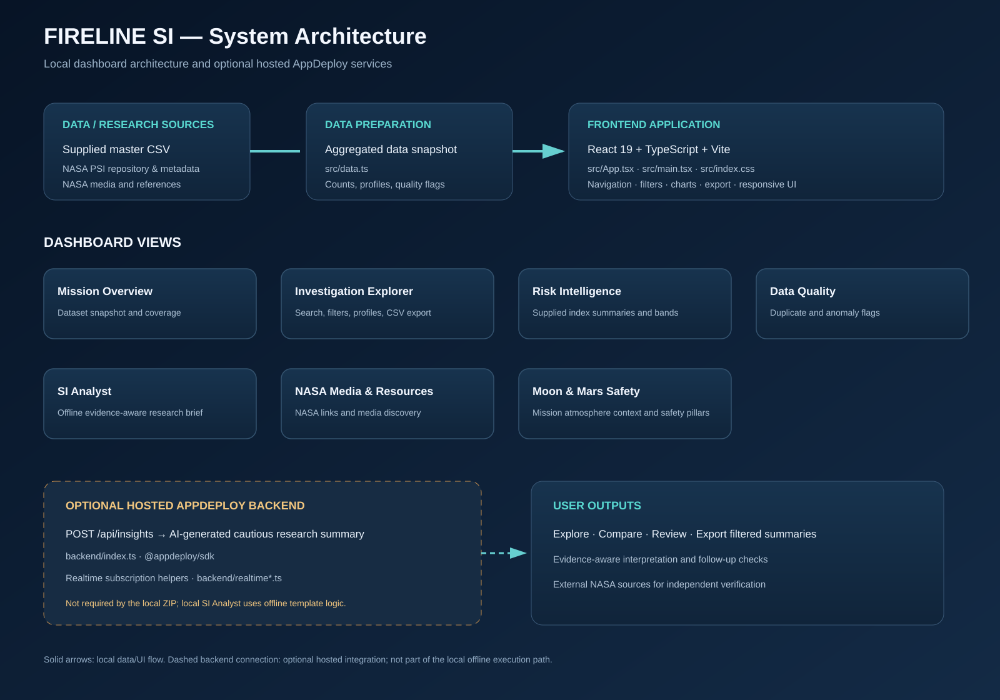

### Architecture layers

1. **Research/source layer:** The supplied NASA combustion master CSV and NASA PSI/challenge resources are the upstream research references. Verify individual records against their original NASA metadata before reuse.
2. **Prepared data layer:** The local build uses precomputed aggregate investigation/category/fuel summaries and quality flags stored in `src/data.ts`.
3. **Presentation layer:** `src/App.tsx` implements seven dashboard views; `src/index.css` provides styling; `src/main.tsx` mounts the React application.
4. **Interaction layer:** Users navigate views, search/filter investigation summaries, inspect visual comparisons, review quality flags, and export filtered summaries.
5. **SI interpretation layer:** The local version provides an offline template-based research brief. The optional hosted backend example in `backend/index.ts` describes an AppDeploy AI endpoint; it is not called by the local offline build.
6. **Verification layer:** Users follow NASA PSI and source links to validate unusual values, units, and interpretations. The dashboard does not replace scientific review.

### End-to-end data workflow

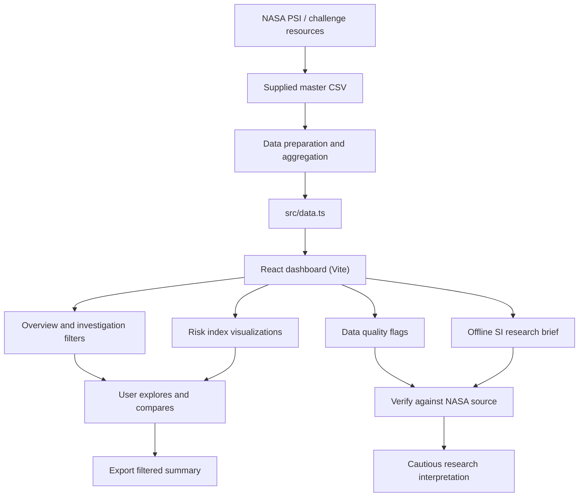

## Screenshots and UI previews

The following screenshots were captured from the running FIRELINE-SI dashboard. They show all seven dashboard modules; NASA Media & Resources is presented in two screenshots to include its full content.

### 1. Mission Overview
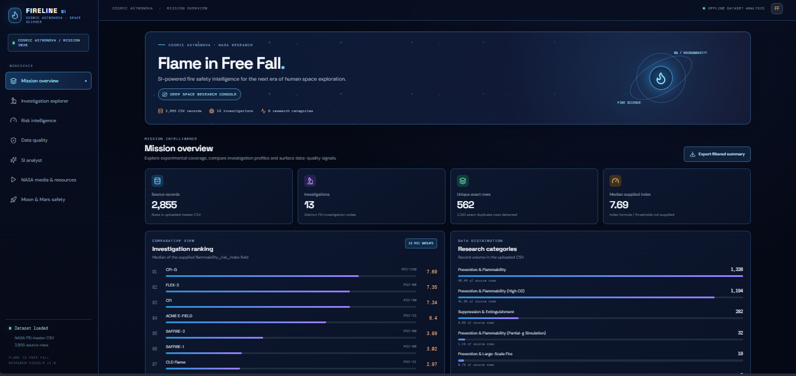

### 2. Investigation Explorer
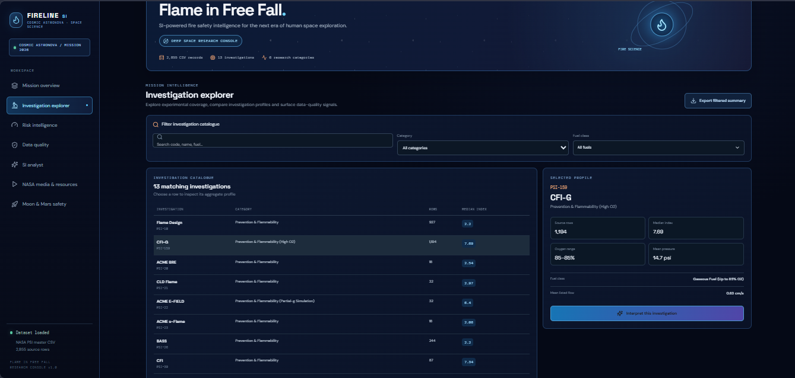

### 3. Risk Intelligence
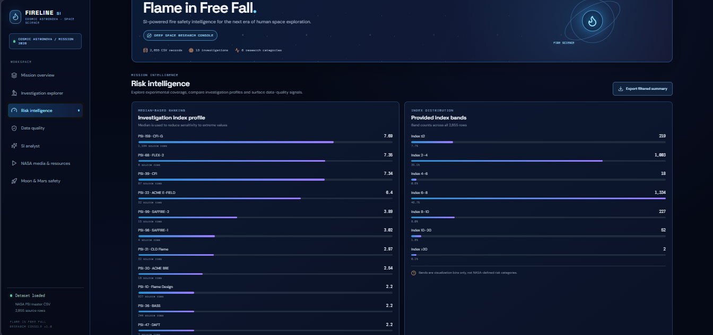

### 4. Data Quality
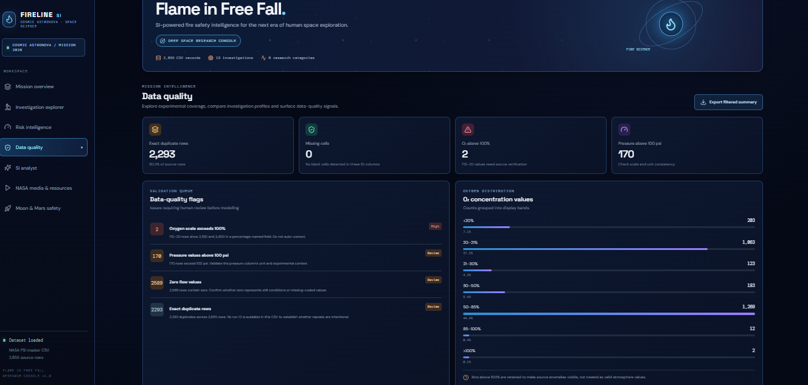

### 5. SI Analyst
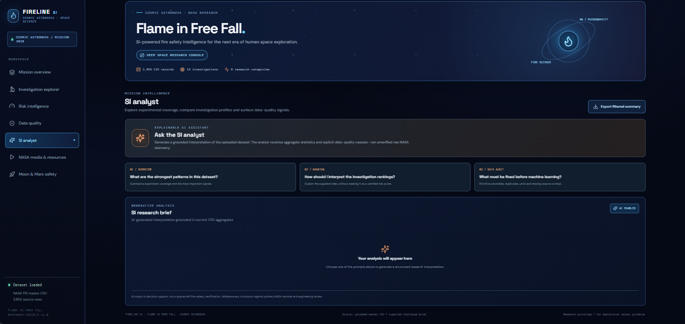

### 6. NASA Media & Resources

**Part 1 — NASA media and research resource cards**

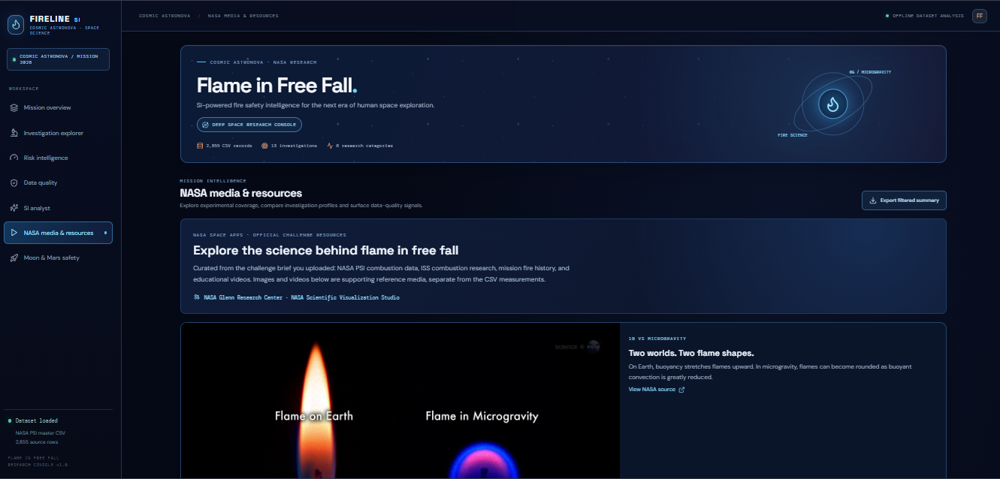

**Part 2 — Featured research video and official links**

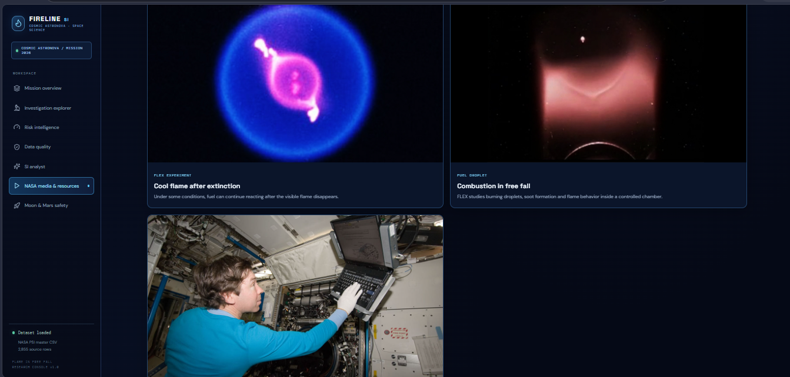

### 7. Moon & Mars Safety
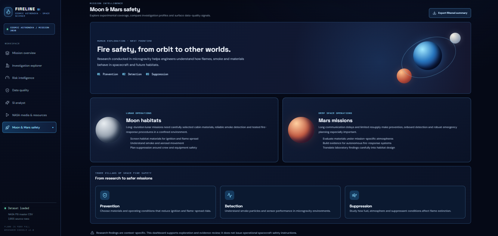


## Resources and references
- [NASA Space Apps Challenge — Flame in Freefall](https://www.spaceappschallenge.org/2026/challenges/flame-in-freefall/)
- [NASA Physical Sciences Informatics](https://psi.nasa.gov/)
- [NASA PSI Repository](https://psi.nasa.gov/physci/repo/)
- [NASA Science — Data Entry Points](https://science.nasa.gov/learn/entry-points-to-nasa-data/)
- [NASA Images and Videos](https://images.nasa.gov/)

NASA names, logos, media, and research data remain subject to their respective ownership, usage, and attribution terms. The MIT License below applies to the original project code and documentation in this repository; it does not automatically relicense NASA data or third-party media.

## Team
- **Kashaf**
- **Mishkat**
- **Zain ul Abideen**

## License
This project is licensed under the MIT License. See [`LICENSE`](LICENSE) for details.
